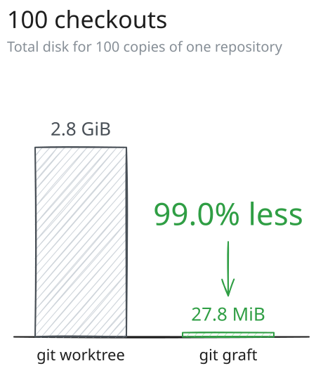
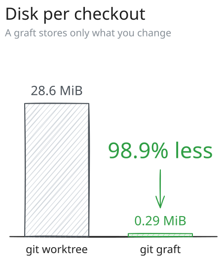
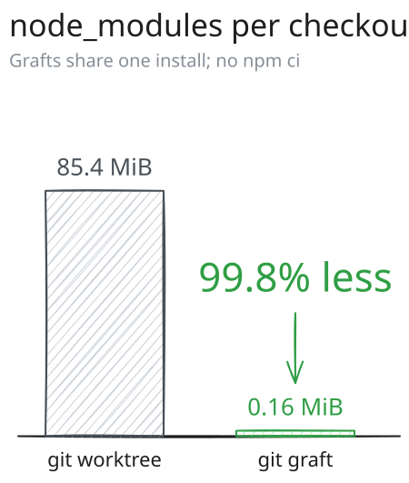
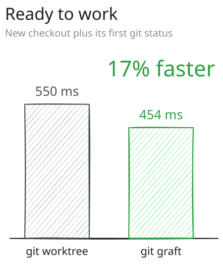
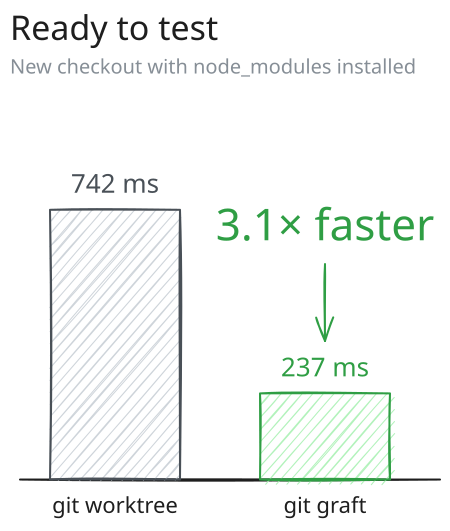

<div align="center">

# git-graft

Run hundreds of coding agents on one repository without filling your disk.

[](https://github.com/mprync/git-graft/actions/workflows/ci.yml)
[](https://github.com/mprync/git-graft/releases)
[](https://crates.io/crates/git-graft)
[](https://www.rust-lang.org)
[](LICENSE)

<picture>
  <source media="(prefers-color-scheme: dark)" srcset="docs/assets/scale.dark.svg">
  
</picture>

</div>

git-graft is a faster, lighter alternative to `git worktree`. It gives each task, or each coding agent, its own complete Git repository next to your checkout. Unchanged files share their disk blocks with your checkout, so a graft stores only what you change, and installed dependencies are shared instead of installed again. Agents such as Claude Code, Codex and Cursor use it through a built-in MCP server.

## Installation

macOS and Linux:

```sh
curl -fsSL https://raw.githubusercontent.com/mprync/git-graft/main/install.sh | sh
```

Homebrew:

```sh
brew install mprync/tap/git-graft
```

Windows (PowerShell):

```powershell
irm https://raw.githubusercontent.com/mprync/git-graft/main/install.ps1 | iex
```

Scoop:

```powershell
scoop bucket add mprync https://github.com/mprync/scoop-bucket
scoop install git-graft
```

Cargo:

```sh
cargo install --locked git-graft
```

There are also `.deb`, `.rpm`, `.apk` and Arch packages on the [releases page](https://github.com/mprync/git-graft/releases), and winget (`winget install mprync.git-graft`) and Chocolatey (`choco install git-graft`) packages once their reviews finish. git-graft needs Git 2.46 or newer. The install scripts verify every download against the release checksums; see [installation](docs/install.md) for upgrades, uninstalling and verifying provenance.

## Getting started

Create a graft from any Git checkout:

```sh
git graft add fix-parser
```

It prints the graft's `path` and a `lease`, a secret that proves the graft is yours. Keep the lease out of logs.

Work in the graft like any other repository:

```sh
cd ../myrepo.graft/fix-parser
git commit -am "Fix the parser"
```

When you're done, merge it into `main` from your checkout:

```sh
git graft merge fix-parser --lease <lease>
```

Merging archives the graft rather than deleting it, and returns a `recovery_lease`; `git graft restore fix-parser --lease <recovery_lease>` brings it back. Use `--into <branch>` to merge somewhere else, and `git graft list` to see every graft.

### Sharing dependencies

Install your dependencies once in your checkout and share them:

```sh
npm ci
git graft deps share --key node24
```

Every graft you create afterwards gets a writable `node_modules` that takes almost no extra space, without running `npm ci` again.

## Using it with coding agents

git-graft includes an MCP server. Give your agent the path to your repository.

Claude Code:

```sh
claude mcp add git-graft -- git-graft --repo /path/to/project mcp
```

Codex, in `~/.codex/config.toml`:

```toml
[mcp_servers.git-graft]
command = "git-graft"
args = ["--repo", "/path/to/project", "mcp"]
```

Cursor, in `.cursor/mcp.json`:

```json
{
  "mcpServers": {
    "git-graft": {
      "command": "git-graft",
      "args": ["--repo", "/path/to/project", "mcp"]
    }
  }
}
```

Any other MCP client works the same way: a stdio server whose command is `git-graft` with the arguments `--repo <path> mcp`. Add `--allow-exec` after `mcp` to let agents run commands and install packages inside their grafts.

Each agent creates, works in and merges its own graft, and proves ownership with its lease, so agents can't interfere with each other or with your checkout. The [agent guide](skills/git-graft/SKILL.md) describes the tools.

## Benchmarks

<p align="center">
  <picture><source media="(prefers-color-scheme: dark)" srcset="docs/assets/disk.dark.svg"></picture>
  <picture><source media="(prefers-color-scheme: dark)" srcset="docs/assets/dependencies.dark.svg"></picture>
  <picture><source media="(prefers-color-scheme: dark)" srcset="docs/assets/speed.dark.svg"></picture>
  <picture><source media="(prefers-color-scheme: dark)" srcset="docs/assets/speed-dependencies.dark.svg"></picture>
</p>

These are medians from the release build on macOS with APFS, comparing `git worktree add` (plus `npm ci` where dependencies are involved) with `git graft add` on the same repositories. In very small repositories, under about two thousand files, a worktree is still quicker to create, but the disk savings hold at every size. The [benchmarks page](docs/benchmarks.md) has the method, the raw data and how to rerun each one.

## Supported platforms

git-graft runs on macOS, Linux and Windows. Disk sharing needs a filesystem that can clone files: APFS on macOS, or Btrfs and XFS on Linux. On ext4 and NTFS grafts still work, with private repositories, merging, archives and the MCP server, but their working files are full copies, as with a worktree. On Linux a graft still shares the primary's Git history there, through hard links to its object files. Run `git graft doctor` to see what your filesystem supports.

## How it works

`git graft add` creates a standalone Git repository next to your checkout and asks the filesystem to clone its files instead of writing them. The clones share data blocks with your checkout until you edit them. A graft mirrors your checkout: before reusing a file, git-graft proves that Git's own line-ending conversion of it, the one `git status` and `git add` apply, gives exactly the committed content, using Git's own index check or a hash of the converted bytes. The graft keeps your checkout's line endings, and Git in the graft agrees every file is unchanged. Files with a filter, `ident` or a working-tree encoding, and anything git-graft cannot prove, come from Git. It also records each file's metadata in the new index, so the first `git status` reads no file contents.

Creating a graft never changes your checkout, and never copies untracked or ignored files into the graft. Merging reports conflicts before it changes anything, and `merge`, `remove` and `prune` archive a graft instead of deleting it. See [safety and recovery](docs/safety.md) for the details.

## FAQ

**How is this different from `git worktree`?**
A worktree writes a full copy of every file, shares your repository's object store, refs and stash, and allows one checkout per branch. A graft is a standalone repository with its own objects, branches, reflog, stash and index, so any branch name works and your repository isn't written to while the graft is in use. On a filesystem that can clone files, it stores only the files you change.

**Why not `cp -c` or `cp --reflink`?**
Cloning a directory copies everything in it, including untracked and ignored files, local edits and Git's internal state, and nothing checks the files against a commit. A graft starts from the commit you choose, leaves untracked and ignored files behind, verifies every reused file, and adds merging, archives and the MCP server.

**Why not `git clone --shared` or `--reference`?**
Both borrow Git objects from the original repository but still write every working file in full, and the clone breaks if the original's objects move or are garbage-collected. A graft shares file data through the filesystem and keeps its own snapshot of the objects it needs.

**What about Jujutsu workspaces?**
They need `jj` and write a full working copy for each workspace. git-graft works with plain Git and the tools you already use.

**Is my work safe if something crashes?**
Every operation can be retried after an interruption, and archived grafts can be restored. Archives are not backups, so keep your own backups for disk failure. See [safety and recovery](docs/safety.md).

## Documentation

- [Installation](docs/install.md)
- [Commands, merging and recovery](docs/operations.md)
- [Grafts and dependency sharing](docs/workspaces.md)
- [Safety and recovery](docs/safety.md)
- [Benchmarks](docs/benchmarks.md)
- [Agent guide](skills/git-graft/SKILL.md)

Every command also has `--help`, and `git graft --help` shows the full manual.

## Contributing

Bug reports and pull requests are welcome. See [CONTRIBUTING.md](CONTRIBUTING.md) to build git-graft and run its tests, and [SECURITY.md](SECURITY.md) to report a vulnerability privately.

## License

git-graft is released under the [MIT license](LICENSE).
